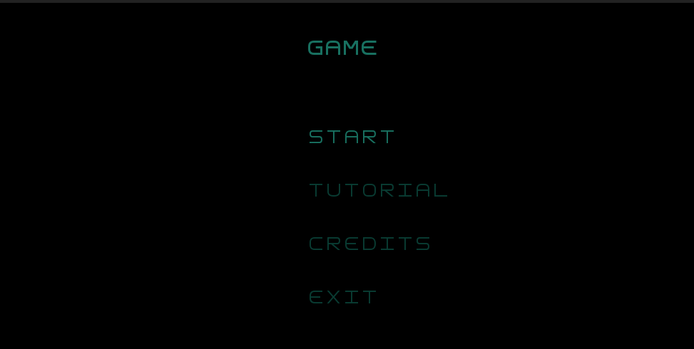

Features implemented :
    
    Modular approach to all packages (controller, gui, model, state, view)
    User friendly and aesthetically pleasing Main Menu
    First objects (player and walls) 
    Working collision
    Rudimentary testing for existing functions

Features for future implementation : 
    
    Add more elements (different monsters, doors, levers, chests and items for example)
    Add design to elements (simple but not a letter) 
    Implement health and damage to living elements
    Room Building from a .txt file and different rooms

    Spear attacks : close range trhust and a long range spear throw.
    Player collects elementar energy from creatures, this energy can be used to heal, while healing player can't move or attack, getting damaged cancels the heal.
    Player cannot move while attacking.

Design Patterns:
    
    The project is separated into packages that all play a different part in the final result (controller, state, model, gui).
    The screen updates smoothly and quickly seaming like all the drawing process is done simultaneously.
    A game loop runs continuously during gameplay. Each turn of the loop, it processes user input without blocking, updates the game, and displays it.
    Abstract base classes define general methods. Derived subclasses that represent different kinds of their parent class implement those methods.
    Generic classes of type T are used to accomodate and connect similar classes that implement the same methods but for diferent objects.
    

Code Smells:

    Collision is suboptimal and requires a player to always be associated with a room and a room associated with a player, might cause confusion in later development.
    Rooms at the moment constain player and walls separately and are not based on element at all, this will get worse the more elements that are put in the game.
    
 Images:   

    Current menu state:
     
