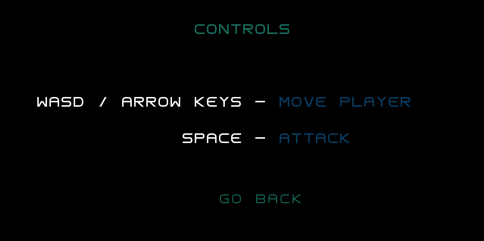
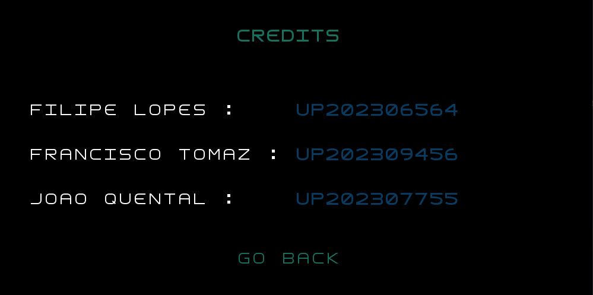
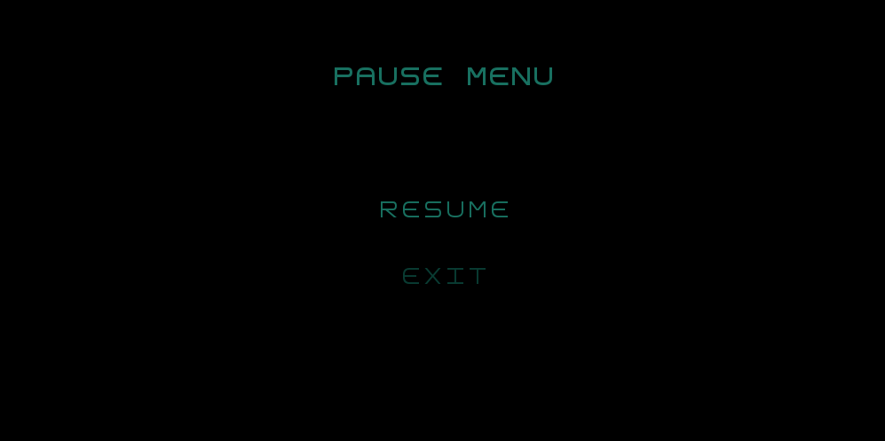
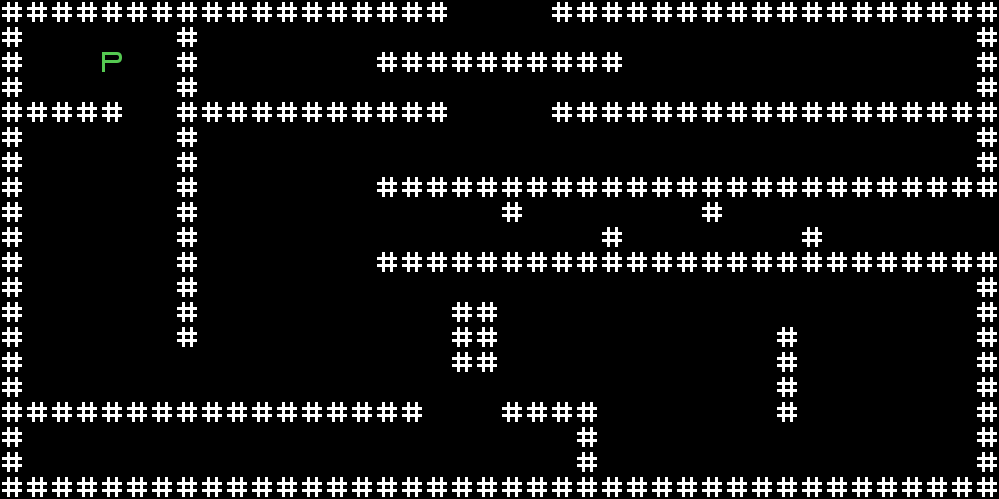

Features implemented :
    
    Modular approach to all packages (controller, gui, model, state, view)
    User friendly and aesthetically pleasing Main Menu
    First objects (player and walls) 
    Working collision
    Rudimentary testing for existing functions

Features for future implementation : 
    
    Add more elements (different monsters, doors, potions, keys, chests and items for example)
    Add a Map to see the multiple rooms
    Add design to elements (simple but not a letter) 
    Implement health and damage to living elements

    Spear attacks : close range trhust and a long range spear throw.
    Player collects elementar energy from creatures, this energy can be used to heal, while healing player can't move or attack, getting damaged cancels the heal.
    Player cannot move while attacking.

Design Patterns:
    
    MVC architetural pattern: The project is separated into packages that all play a different part in the final result (controller, state, model, gui).
    Game loop Pattern: A game loop runs continuously during gameplay. Each turn of the loop, it processes user input without blocking, updates the game, and displays it.
    State pattern: The game is controlled by a state class that defines which displayers or controllers are in use.
    Factory method Pattern: Current state sublcass is the one who calls both the controller and the displayer for that specific state.

Code Smells:

    Collision is suboptimal and requires a player to always be associated with a room and a room associated with a player, might cause confusion in later development.
    Rooms at the moment constain player and walls separately and are not based on element at all, this will get worse the more elements that are put in the game.
    GameDisplayer call each element displayer 1 by 1 (PlayerDisplayer, WallDisplayer), we can probably generalize this with an ElementDisplayer.
    Multiple MenuDisplayers and Controllers doing similiar tasks probably should make an abstract class for both displayers and controllers.
    
 Images:   

    Current Main menu:

    
    Current Constrols Menu:

    
    Current Credits Menu:

    Current Pause Menu:

    First Game preview:

