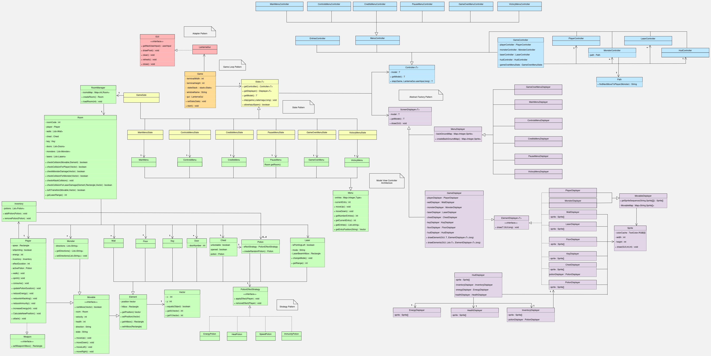
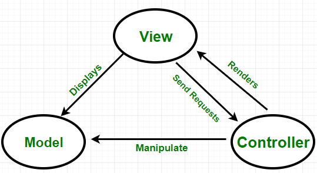
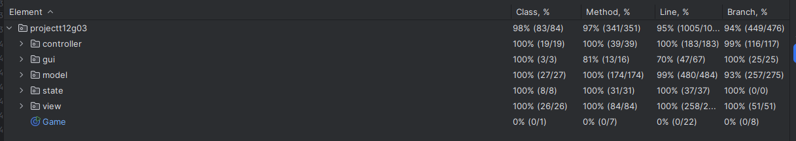
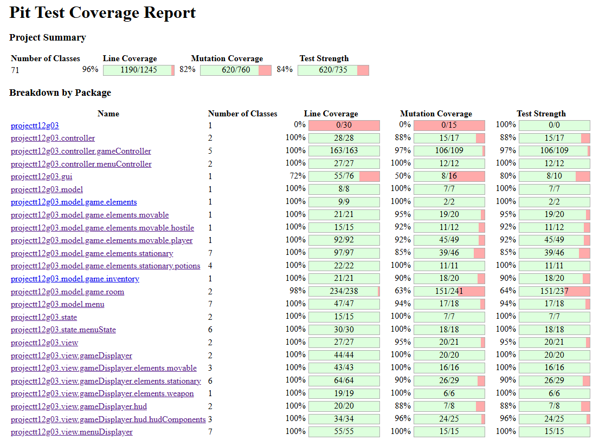

<h1 align="center">
    LDTS-T12G03 - Spear Boy
</h1>

    

>

> Filipe Lopes (up202306564@up.pt), Francisco Tomaz (up2023xxxxx@up.pt) and João Quental (up2023xxxxx@up.pt)
>

Spear Boy is a 2D top-down dungeon-style adventure game where the main character, armed with his trusted spear, 
finds himself lost in a mysterious and treacherous jungle. Here, he must face off against the cunning and unpredictable 
native inhabitants, the "Cool Monkey" tribe. With lasers and tribe members lurking at every turn, the jungle will test the hero's
courage, skill, wit and humility. Can Spear Boy overcome the jungle's challenges and escape to tell his tale, or will this 
journey mark the end of his story?

## Index

- [In Depth Controls](#controls)
- [Features](#features)
- [Project Structure](#uml)
- [Design Patterns](#design)
  - [Model-View-Controller Pattern](#Model-View-Controller)
  - [State Pattern](#State-Pattern)
  - [Game Loop](#Game-Loop)
  - [Abstract Factory Pattern](#Abstract-Factory-Pattern)
  - [Adapter Pattern](#Adapter-Pattern)
  - [Strategy Pattern](#Strategy-Pattern)
- [Code Smells](#code-smells)
- [Testing](#testing)
  - [Coverage Testing](#unit-coverage)
  - [Pitest](#pitest-coverage)
- [Self Evaluation](#SELF-EVALUATION)

## CONTROLS

`W or ^`: Moves the player or cursor(menus) up.

`A or <`: Moves the player to the left.

`S or v`: Moves the player or cursor(menus) down.

`D or > `: Moves the player to the right.

`SPACE`: Makes the player attack with his spear and triggers a timed delay to when the player can process another input.

`SHIFT`: Makes the player run losing stamina over time, his speed is increased by a factor of 2.

`ESC`:  Pauses the game if it is running.

`ENTER`: Selects the desired option in the menus or consumes the selected item in the inventory while in the game.

`H`: Heals one of the players hearths at the cost of a full stamina bar.

`1, 2, 3, 4`: Selects the corresponding item slot in the players inventory.

## FEATURES

- **Main Menu Screen** - Simple but appealing menu screen when launching the game, which allows the user to choose between starting the game, 
accessing the controls menu, the credits menu or exiting the application. The main menu screen design already sets the tone for the game and 
how it is going to look like.

- **Controls Menu Screen** - Easy to access controls menu, follows the theme from main menu and displays all the needed information to play the 
game in a concise manner.

- **Credits Menu Screen** - Easy to access menu where all the game creators names are displayed following the games theme to not break immersion.

- **Pause Menu** - Can be accessed by pressing ESCAPE at any point while playing the actual game. It pauses the current game state and prevents it from updating
until the player resumes the game by selecting the resume option. Also allows the option to go back to the main menu to either restart the game or exit at any point.

- **Death Condition and Game Over Screen** - When the player health reaches zero, it dies and a one of two different game over screens is displayed depending on the players actions during the play-through.

- **Multiple Endings** - When the player finds is way out of the jungle one of two different ending screens is shown according to the players actions during the play-trough.
** **
- **Room Manager** - Class to create rooms based on written text files with specific characters, allowing a simpler element generation 
and organization inside each room and allowing simple layout editions. It also loads rooms that were already created making it so any changes made to that room were not overwritten. 

- **Multiple rooms and Doors** - the jungle is built upon multiple rooms connected with door objects creating the illusion that the player is actually moving through connected rooms and
allowing him to move freely in the jungle. 

- **Sprite Image Loader** - Class that loads PNG images into the game and can then represent them pixel by pixel on the screen, using Lanterna. 
This is used for the player, ground tiles, walls, door tiles, monsters, chests, keys, potions, lasers and laser beams.
** **
- **Player Movement** - The player can move (using either arrow keys or WASD), attack (Space bar), heal (H), sprint (SHIFT) and manage his 
inventory. All The player's movement and attack animations change according to the player's current direction. The sprint action also speeds up the normal
walking animation.
 
- **Interactive UI** - The player can interact with his inventory by choosing a inventory slot or consuming an item in the chosen inventory slot.
  
- **Health and Stamina** - Player has both a health amount and a stamina amount. The health decreases when the player touches an enemy or a laser beam and
increases when a player uses the heal action or consumes a health potion. The stamina decreases over time when the player is sprinting or fully when the player uses the heal action
and increases over time when the player is not sprinting, and partially (25%) when the player consumes an energy potion.

- **Immunity** - When the player is damaged there is a cooldown until he can be damaged again. This effect is also used in the immunity potion. 

- **Spear attack** - When the player attacks using SPACE a spear object is created in the direction the player is facing and all the enemies who collide with
its hit box while the attack is happening will suffer damage.
** **
- **Enemies and Path** - Enemies have different animations according to their direction and walk randomly through the map until the player gets close, if the player is close to an enemy it
will stop walking randomly and employ a simple path class that forces them to get to the player. 

- **Lasers** - Laser elements can point either to the left or right and can be either "RESTING" serving just as normal wall or "ACTIVE" releasing a laser beam until it hits a wall, an enemy or the player, 
damaging only the player as the enemies are clearly wearing sunglasses.

- **Chests and Keys** - Chests can be opened if the player touches them while having a key in their possession, keys can be picked up by touching them as well. When a chest is open it will disappear 
and a potion with a random effect will take its place.

- **Potions** - A Potion can a have different effect (energy: heals 25% of the maximum stamina, health: heals one heart of health, speed: multiplies the players movement speed by a factor of 2 for 10 seconds, 
immunity: player cannot suffer damage for 20 seconds). The effect os chosen randomly based on the PotionEffectStrategy Interface.
** **

## UML

- [UML](UMLSpearBoy.drawio.png)

    

## DESIGN

### Model-View-Controller

**Problem in Context** 
- In Spear Boy, where gameplay involves interactions between the environment, enemies, and the player’s actions, it is important ensures these layers of functionality are well-structured 
and adaptable for future updates. The code needs to be well-organized and separated so that the Single Responsibility Principle isn't broken.

**The Pattern**
- **Model/View/Controller** - Very common pattern in Graphical User Interfaces (GUI). It structures the code in three different sections:
    - **Model** - Used to represent the data, rules and game logic.
    - **View**  - Manages the rendering of the game (e.g., drawing Spear Boy, walls and enemies). This keeps display logic independent of game rules or input handling.
    - **Controller** - Provides a model to obtain and interpret user inputs.

**Implementation** 
- **Main menu example:**
  - [MainMenuModel](../src/main/java/projectt12g03/model/menu/MainMenu.java).
  - [MainMenuDisplayer](../src/main/java/projectt12g03/view/menuDisplayer/MainMenuDisplayer.java).
  - [MainMenuController](../src/main/java/projectt12g03/controller/menuController/MainMenuController.java).

    

**Consequences**
- **Easier to extend:** - The code is more modular, so if new features were to be added there would only be needed updates on specific parts of the code.
- **Simplified Testing:** - Since all parts are independent, you can, for example, easily write unit tests for game logic without needing to worry about rendering or input code.
- **Parallel Development:** - Developers can work on different components simultaneously. One developer can work on gameplay mechanics (Model), while another works on rendering (View), and another handles input systems (Controller).

### State Pattern

**Problem in Context**
- Games often involve distinct states, such as menus, gameplay and game over screens. Without a structured way to manage these transitions, a game can become cluttered with complex conditionals and intertwined logic. 
In Spear Boy, for example, the game must switch seamlessly between the menus, game ending screens, and gameplay. Managing these states directly within the game logic can lead to tightly coupled, error-prone code that is hard
to extend or debug.

**The Pattern**
- **State Pattern** - Pattern that provides a way to organize behavior into distinct states, each encapsulated in its own class. Instead of the game being aware of all states and their transitions, 
the pattern delegates state-specific behavior to individual classes. Each state handles its behavior independently, and the game switches states by changing the current state object. 
- This approach avoids complex conditional logic and creates a clean, modular design.

**Implementation**
- This pattern is present in all the classes inside the state package.

**Consequences**
- **Modularity:** Each state is encapsulated, making it easier to manage and test independently.
- **Simplified Transitions:** The game only needs to switch the current state object, avoiding complex logic.

### Game Loop

**Problem in Context**
- In most games, a continuous and efficient flow of logic is required to handle updates, rendering, and input processing. Without a structured way to manage these tasks, 
a game may suffer from inconsistent performance, difficult debugging, and poor scalability. For instance, in Spear Boy, the game must handle user inputs 
(like moving or attacking), update enemy behaviors, and render the visuals, all in a synchronized, timely manner. 
Failing to manage this loop effectively could lead to stuttering gameplay or missed inputs.

**The Pattern**
- **Game Loop** - Pattern that provides a centralized structure for managing the game's flow by repeatedly cycling through a loop where:
  - Player and random enemy inputs are processed.
  - The game is updated based on its logic and rules.
  - The updated game is drawn on the screen.
- In Spear Boy the game loop occurs 15 times per second (15fps)

**Implementation**
- **GameClass** - [Game](../src/main/java/projectt12g03/Game.java).
- **Controlled time and performance:** Elapsed time is measured in each iteration and adjusted to process or sleep as necessary to maintain the desired frame rate.

**Consequences**
- **Consistency:** The loop ensures regular updates, keeping gameplay responsive and smooth.
- **Performance Control:** By managing frame timing, the game remains stable across different hardware setups.
- **Complexity in Frame Management:** Ensuring updates and rendering fit within the allocated time can be sometimes difficult for element-heavy rooms.

### Abstract Factory Pattern

**Problem in Context**
- Games often need to create families of related objects, such as UI elements, enemies, weapons, or environmental features. These objects might share common traits or 
behaviors but need to be instantiated with specific configurations. For example in Spear Boy, all the menus share similar traits, also all the elements and furthermore 
the movable elements like the player and the enemies. Managing these object families through conditional logic scattered throughout the code can result in a brittle, difficult to test and manage and unscalable system.

**The Pattern**
- **Abstract Factory Pattern** - Pattern that provides an interface or abstract class for creating families of related or dependent objects without specifying their concrete classes. This pattern encapsulates object creation in a way that 
allows the game to produce consistent sets of objects tailored for specific contexts or themes (e.g. Main Menu, Controls Menu, Credits Menu, Pause Menu).

**Implementation**
- Abstract Classes like:
  - [Menu](../src/main/java/projectt12g03/model/menu/Menu.java).
  - [Movable](../src/main/java/projectt12g03/model/game/elements/movable/Movable.java).
  - [State](../src/main/java/projectt12g03/state/State.java).
  - [Element](../src/main/java/projectt12g03/model/game/elements/Element.java).
  - [Controller](../src/main/java/projectt12g03/controller/Controller.java).

**Consequences**
- **Encapsulation of Creation Logic:** - The instantiation of objects is centralized and modular.
- **Consistency:** Ensures all objects within a family are compatible and work together seamlessly.

### Adapter Pattern

**Problem in Context**
- The LanternaGui class serves as a graphical interface for Spear Boy, relying on the Lanterna library. While Lanterna provides robust capabilities for terminal-based GUIs, 
integrating it directly into the game might tightly couple the game logic to the library. This poses several issues:
  - If the team decides to switch to another GUI library, the game logic would need significant rewriting.
  - The direct use of the library's API could make testing harder and reduce flexibility.
  - The direct use of the API makes the code less modular.
- A solution is needed to decouple the game logic from the specifics of the GUI implementation, enabling easier adaptability and testing.

**The Pattern**
- **Adapter Pattern** - The Adapter Pattern acts as a bridge between incompatible interfaces. It allows the game logic to interact with the GUI through a unified interface, while the adapter handles the underlying details of the specific GUI library.
For LanternaGui, this means providing a consistent GUI interface that hides Lanterna-specific functionality, ensuring the game logic remains independent.

**Implementation**
- The pattern includes both the GUI interface and the lanternaGui:
  - [GUI](../src/main/java/projectt12g03/gui/GUI.java).
  - [LanternaGui](../src/main/java/projectt12g03/gui/LanternaGui.java).

**Consequences**
- **Flexibility:** The game logic is decoupled from Lanterna, allowing for easy switching to a different GUI library.
- **Testability:** Mock or alternative implementations of the GUI interface enable seamless testing without requiring Lanterna.
- **Simplified Integration:** The GUI interface provides a clean abstraction, reducing the complexity of the game logic.

### Strategy Pattern

**Problem in Context**
- In Spear Boy, potions provide various effects such as healing, energy, speed or temporary invincibility. Implementing each potion’s effect directly in the game logic could lead to a
hard-to-maintain design. To address this, the game needs a way to encapsulate potion behavior while making it easy to add or change potion effects without altering the core logic.

**The Pattern**
- **Strategy Pattern** - Pattern that allows defining a family of behaviors (potion effect apply and remove for example), encapsulating them as separate classes, and making them interchangeable. 
This enables the behavior of a potion to vary independently of its type or other potions in the game.

**Implementation**
- The strategy pattern is implemented in the following files
  - Interface with the needed methods: [PotionEffectStrategy](../src/main/java/projectt12g03/model/game/elements/stationary/potions/PotionEffectStrategy.java).
  - Potion class that selects a potion at random: [Potion](../src/main/java/projectt12g03/model/game/elements/stationary/Potion.java).
  - All the different types of potion: [HealPotion](../src/main/java/projectt12g03/model/game/elements/stationary/potions/HealPotion.java), [EnergyPotion](../src/main/java/projectt12g03/model/game/elements/stationary/potions/EnergyPotion.java), [SpeedPotion](../src/main/java/projectt12g03/model/game/elements/stationary/potions/SpeedPotion.java), [ImmunityPotion](../src/main/java/projectt12g03/model/game/elements/stationary/potions/ImmunityPotion.java).

**Consequences**
- **Extensibility:** Adding new potions requires only creating a new Potion with the strategy methods implementation without heavily modifying existing code.
- **Separation of Concerns:** The behavior of each potion is encapsulated in its own class, simplifying the Potion class and making the effects easier to test and reuse.

## CODE-SMELLS

- **Really complex Room class** - Room is a cluttered class with a lot of attributes and methods (mainly collision checks) even tough these methods are needed and are directly related
to the room, the class is still really cluttered making it really hard to test.
- **Non-efficient Collision checking** - The collision method used is outdated and is really computationally intensive in rooms with lots of elements. A better approach would involve devising a grid system and 
only check the collision for the elements in the same grid, for example.
- **Rudimentary PathFinding** - Initially it was used the A* algorithm for pathfinding but, because the screen was later changed to 320x288 instead of 40x20 to insert sprites,
the game would lag and there would be a huge time between frames making it unplayable because the path finding algorithm needed to create a stupendous amount of nodes to get anywhere. To solve the issue a simple algorithm was created so the enemies would only check
the next move each iteration. Making the game smoother but generating bugs like monsters hugging walls in specific situations.
- **DisplayerHubs** - Classes like GameDisplayerHub and HudDisplayerHub are used only for help in testing as serve no purpose for the actual game.
- **Unused overridden functions** - Some elements implement interfaces but do not use all the functions included, for example the HealPotion class implements the PotionEffectStrategy but does not need or use the removeEffect function. This happens a considerable number of times.

## TESTING

### Unit Coverage

  - Method Coverage = 97%
  - Line Coverage = 95%
  - Branch Coverage = 94%

    

### Pitest Coverage

  - Line Coverage = 96%
  - Mutation Coverage = 82%
  - Test Strength = 84%

    

## SELF-EVALUATION
  - Filipe Lopes: 33.3%
  - Francisco Tomaz: 33.3%
  - João Quental: 33.3%

